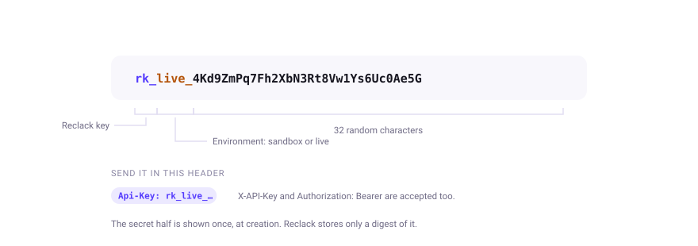
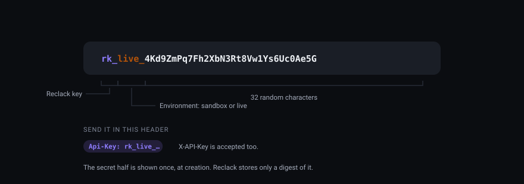

Every call to the Reclack API is authenticated with an API key. The key also
decides which environment you are talking to, so there is no separate sandbox
host to remember.

<Frame caption="What a key is made of, and the headers it can travel in">
  
  
</Frame>

## Key format

| Prefix | Environment | What it touches |
| --- | --- | --- |
| `rk_sandbox_` | Sandbox | Test chains and test money. Nothing of value moves. |
| `rk_live_` | Live | Real networks, real stablecoins, real settlement. |

A key is shown once, when it is created. We store only a digest of it, so we
cannot show it to you again and a database dump yields nothing usable. If you
lose a key, revoke it and mint another.

## Sending the key

Send the key in the `Api-Key` header. This is what every example in these docs
uses.

<CodeGroup>

```bash curl
curl "https://api.reclack.com/v1/customers" \
  -H "Api-Key: rk_sandbox_your_key_here"
```

```js Node
const response = await fetch("https://api.reclack.com/v1/customers", {
  headers: {
    "Api-Key": process.env.RECLACK_KEY,
  },
});
```

```go Go
req, _ := http.NewRequest("GET", "https://api.reclack.com/v1/customers", nil)
req.Header.Set("Api-Key", os.Getenv("RECLACK_KEY"))
```

```python Python
import os, requests

requests.get(
    "https://api.reclack.com/v1/customers",
    headers={"Api-Key": os.environ["RECLACK_KEY"]},
)
```

</CodeGroup>

One other header works if your stack already puts credentials somewhere else:

```http
X-API-Key: rk_live_your_key_here
```

We recognise a key by its own shape, so a session token sitting in the same
header is never mistaken for one.

## Publishable keys

A secret key belongs on your server. A page in a browser gets a publishable key
instead, which is public on purpose: it names your workspace and may open a
checkout, and it can do nothing else.

| Prefix | Environment | What it touches |
| --- | --- | --- |
| `pk_sandbox_` | Sandbox | Opening test checkouts. |
| `pk_live_` | Live | Opening real checkouts. |

You already have one. A publishable key is created alongside your first secret
key in each environment, and you can see it in full whenever you like under
**Developers**, then **API keys**. Unlike a secret, it is not hidden after
creation: a value that lives in your own HTML has nothing to hide.

What it can do is fixed at `checkout:write`, whatever permissions you ask for.
It cannot read customers, list payments, mint keys or change settings.

```js
import { Reclack } from '@reclack/widget'

const reclack = Reclack({ publicKey: 'pk_live_8xK2...' })

const session = await reclack.checkout.initialize({
  price_id: 'price_7Fh2PqX9',
  customer: { email: 'dana@acme.dev' },
})
```

It travels in the same headers as a secret key, so a plain request works too:

```bash
curl -X POST "https://api.reclack.com/v1/checkouts" \
  -H "Api-Key: pk_live_8xK2..." \
  -H "Content-Type: application/json" \
  -d '{ "price_id": "price_7Fh2PqX9" }'
```

<Note>
A publishable key is still rate limited and still belongs to one environment. A
`pk_sandbox_` key cannot open a live checkout, and the prefix makes the mistake
obvious before anybody chases it.
</Note>

Need another, or one with a name of its own? Pass `"publishable": true` to
[create a key](/api-reference/credentials/create). The dashboard lists the keys
you have and copies a publishable one in full. Revoking stops it on the next
request, so roll it the same way you would roll a secret.

## What a key can do

Keys carry permissions. A key that only records usage does not need the ability
to create subscriptions, and giving it that ability is how a small mistake
becomes a large one.

| Permission | Covers |
| --- | --- |
| `products:read`, `products:write` | Catalog products and prices. |
| `customers:read`, `customers:write` | Customer records. |
| `subscriptions:read` | Subscriptions and their periods. |
| `usage:write` | Recording metered usage. |
| `invoices:read`, `invoices:write` | Invoices, sending, reminders and charges. |
| `checkout:write` | Creating checkout sessions. |
| `payment_links:read`, `payment_links:write` | Payment links. |
| `webhooks:read`, `webhooks:write` | Endpoints, secrets and deliveries. |

Set these when you create the key in the dashboard. A call made with a key that
lacks the permission is refused with a `permission_error`, not a silent
no-op.

## Keeping a key safe

<Warning>
A secret key is a bearer credential. Anyone holding it can act as your
workspace. Keep it on your server, never in client-side code, a mobile binary,
or a public repository.
</Warning>

A few habits that cost nothing:

- Use separate keys for separate jobs, so one can be revoked without taking the
  rest of your integration down.
- Rotate on a schedule, and immediately when somebody who had access leaves.
- Keep sandbox and live keys in different places. The prefix makes a mistake
  obvious in a log line, which is exactly when you want to notice.
- Never log the key. Reclack does not log secrets, and your service should not
  either.

## Revoking a key

Delete it in the dashboard under **Developers**, then **API keys**, or call the
API:

```bash
curl -X DELETE "https://api.reclack.com/v1/credentials/cred_7Fh2PqX9" \
  -H "Api-Key: $RECLACK_KEY"
```

Revocation takes effect on the next request. Calls already in flight finish.
