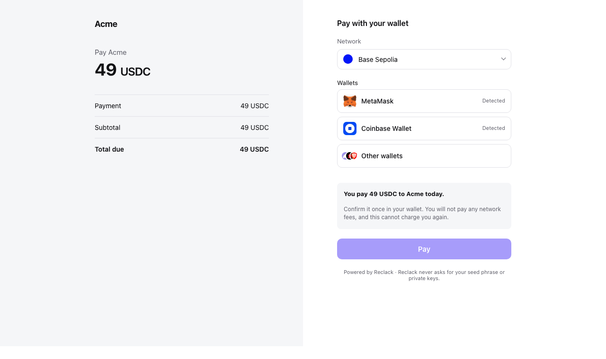
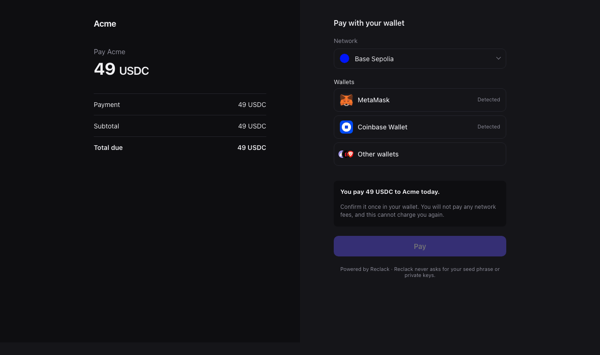

Every page a payer sees carries your branding: the checkout, the receipt and
the billing portal. Set it in the dashboard under **Settings**, then
**Branding**.

## What you set

| Setting | Where it shows |
| --- | --- |
| **Logo** | The top of the checkout and the receipt. An `https` address you host, so nothing can be swapped out later without you |
| **Page tint** | Behind the summary of what the payer is paying for |
| **Button colour** | The button your customer presses |
| **Theme** | Which palette the page opens in: light, dark, or the payer's own system setting |
| **After a payment** | What happens next, in your words, shown once the payment has settled |

A workspace that has set none of this gets Reclack's own look, which is a
deliberate default rather than an unstyled page.

## Light and dark

Pick a theme and then set the two colours for each palette. The dashboard
switches the editor and the preview between them, so you see what you are
choosing.

<Note>
A colour that works on white rarely works on near black. That is why there are
two pairs rather than one pair and an automatic inversion.
</Note>

<Frame caption="One checkout, in the palette the page is wearing">
  
  
</Frame>

Leave the dark pair empty and the dark palette keeps your button colour from
the light one, which survives both, and keeps its own neutral tint, because a
near white tint on a dark page is a glare.

## Who decides the palette

Four answers, and the first one present wins:

1. **The site embedding the checkout**, through the widget's `theme.mode`. It
   knows what the checkout is sitting in, which your setting cannot.
2. **A palette named in the address**, `?theme=dark` on the hosted checkout.
3. **Your stored theme**, from the dashboard.
4. **Light**, if nothing above said otherwise.

```js
// A dark page embedding a light merchant's checkout.
Reclack().launch(reference, {
  container: '#checkout',
  theme: { mode: 'dark' },
})
```

Either way the colours stay yours: the host is choosing which of your two looks
to wear, not replacing it.

`system` is resolved when the page loads rather than left to CSS, so the page
and the wallet picker inside it always agree on the answer, and a checkout
embedded in a light page stays light however the payer's machine is set.

## The wallet picker

The picker the checkout opens is themed from the same values: your button
colour becomes its primary action, and it follows the palette in force. You do
not configure it separately.

If you are using [WalletKit](/sdks/walletkit) in your own pages, it takes the
same twelve tokens directly.

## Trying it

Open a sandbox checkout and add `?theme=dark` to see the other palette without
changing your setting. The dashboard also previews both, on a phone frame and a
desktop one, as you edit.
