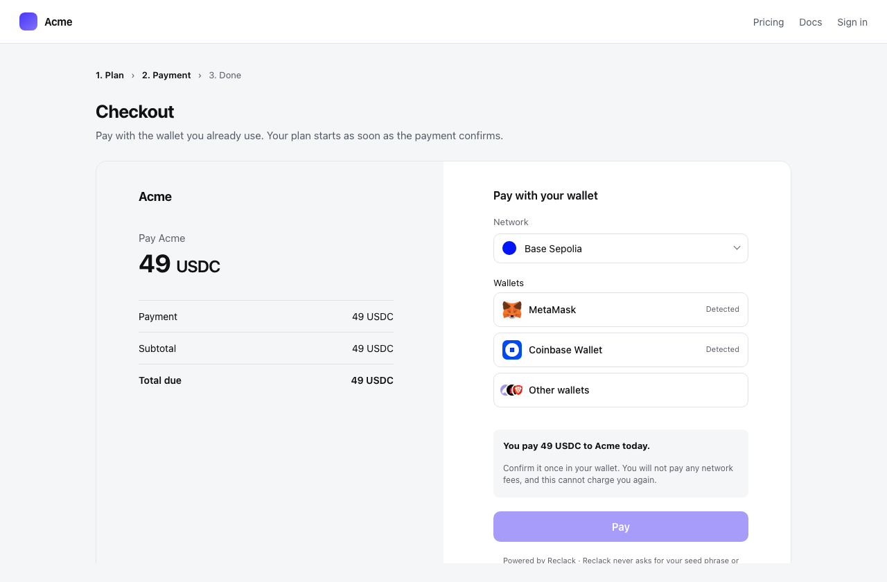
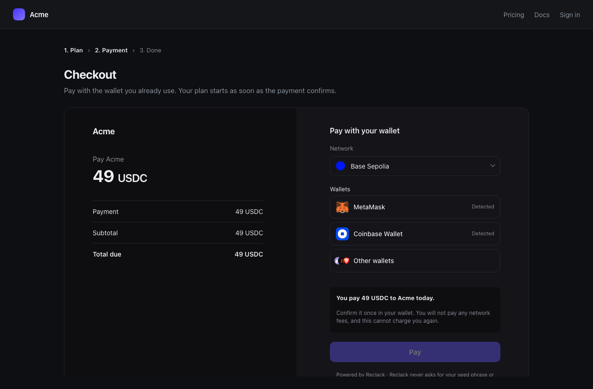
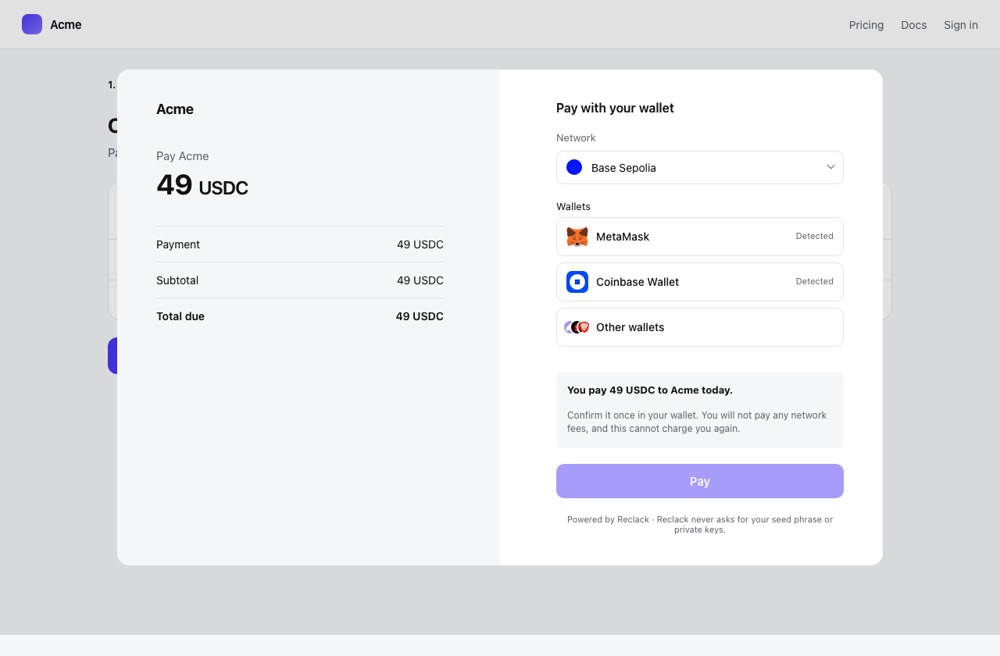
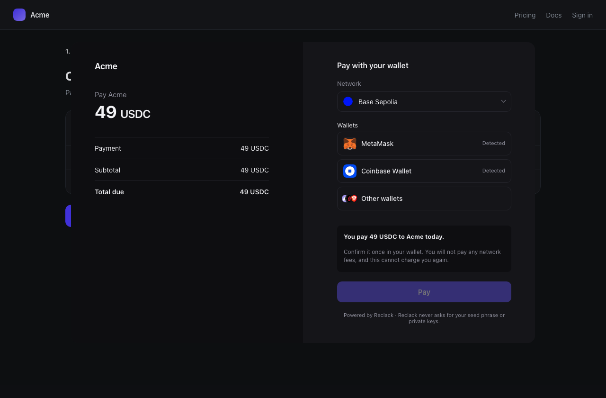

The widget puts the Reclack checkout in your page. Your customer pays without
leaving, and what they are asked to approve is still rendered by us.

<Frame caption="The checkout inline in a merchant's own page">
  
  
</Frame>

```sh
npm install @reclack/widget
```

[`@reclack/widget` on npm](https://www.npmjs.com/package/@reclack/widget)

Or skip the install. One script tag gives you the same thing on `window`:

```html
<script src="https://js.reclack.com/widget.js"></script>
```

Everything below works either way: `import { Reclack } from '@reclack/widget'`
and the global `Reclack` are the same function.

## Launching a checkout your server created

The usual shape. Your backend holds the secret key, creates the thing being
paid, and passes the reference down to the page.

<CodeGroup>

```js npm
import { Reclack } from '@reclack/widget'

Reclack().launch(reference, {
  mode: 'inline',
  container: '#checkout',
  onSuccess: ({ reference }) => router.push(`/thanks/${reference}`),
})
```

```html script tag
<div id="checkout"></div>
<script src="https://js.reclack.com/widget.js"></script>
<script>
  Reclack().launch("chk_7Fh2PqX9Lm", {
    mode: "inline",
    container: "#checkout",
    onSuccess: ({ reference }) => (location.href = "/thanks"),
  });
</script>
```

</CodeGroup>

`reference` is anything a payer can be handed:

| Prefix | What it is |
| --- | --- |
| `chk_` | a checkout session |
| `in_` | an invoice |
| `plink_` | a payment link |

One endpoint resolves all three, so moving from links to invoices changes
nothing here but the string.

## Creating the checkout from the page

For a page with no server of its own to ask. This needs your [publishable
key](/authentication#publishable-keys), which is public on purpose: it names
your workspace and may open a checkout, and can do nothing else.

```js
const reclack = Reclack({ publicKey: 'pk_live_8xK2...' })

const session = await reclack.checkout.initialize({
  price_id: 'price_7Fh2PqX9',
  networks: ['base', 'polygon'],
  customer: { email: 'dana@acme.dev' },
})

reclack.launch(session.reference, { mode: 'popup' })
```

`initialize` returns `{ reference, url }`. The `url` is the hosted page, if you
would rather redirect than embed.

### What you can pass

The fields are the API's own, under the same names, so [the checkout
reference](/api-reference/checkouts/create) and this are the same list.

| Field | What it does |
| --- | --- |
| `price_id` | A catalog price. A recurring one starts a subscription |
| `amount` | What to charge with no price, as `"29.00"`, not base units |
| `networks` | Chains the payer may choose between, the first leading |
| `customer` | `{ email, name }`, or whatever else you know |
| `redirect_url` | Where the payer goes once they have paid. The hosted confirmation by default |
| `fee_payer` | Who bears the fees. The merchant by default |
| `expires_in` | How long the page stays payable, in seconds |
| `metadata` | Your own keys and values, returned on the webhook |

A `price_id` wins over an `amount`. A checkout with neither is one the payer
names the amount on.

<Warning>
Never put a secret key in a page. A page is public, so a secret key in one is a
secret key in everybody's view source. The client throws on `rk_live_` and
`rk_sandbox_` before any request leaves the browser.
</Warning>

## Inline or popup

`mode: 'inline'` puts the checkout in an element of your choosing and grows it
to fit, so your page scrolls as one rather than a box scrolling inside a page.

`mode: 'popup'` puts it over the page in a native `<dialog>`, which brings
focus trapping, Esc to close and an inert background with it.

<Frame caption="The same checkout in popup mode, over the page that opened it">
  
  
</Frame>

```js
const checkout = Reclack().launch(reference, { mode: 'popup' })
checkout.close()
```

`launch` returns `{ frame, close }`: the iframe, if you want to style or move
it, and a way to take it off the page.

## Options

| Option | What it does |
| --- | --- |
| `mode` | `'inline'` or `'popup'`. Inline by default |
| `container` | Where an inline checkout goes: a selector or an element |
| `origin` | A different deployment, such as a sandbox |
| `theme` | How the checkout should look: `mode` for the palette, any other key a colour. See [Appearance](/guides/appearance) |
| `onReady` | The checkout has drawn something |
| `onSuccess` | The payment went through, as far as this browser knows. Carries `redirectUrl` when the checkout set one, for you to navigate to |
| `onError` | Something refused, with a message a person can read |
| `onClose` | They closed it without paying |

## Light and dark

The checkout opens in whichever palette the merchant set in the dashboard,
light unless they changed it. Your page knows something that setting cannot,
which is what the checkout is sitting in, so you can say:

```js
Reclack().launch(reference, {
  container: '#checkout',
  theme: { mode: 'dark' },
})
```

`'light'`, `'dark'` or `'system'`, which follows the payer's own device. It
wins over the stored default, and the colours chosen for that palette are still
used: you are picking which of the two looks to wear, not replacing it.

## Sending them to us instead

Not every page wants a checkout in it. `redirect` sends the payer to the hosted
one, and `redirect_url` on the session brings them back.

```js
Reclack().redirect(reference)
Reclack().redirect(reference, { theme: 'dark' })
```

`url(reference)` gives you the same address without navigating, for a link you
render yourself or a redirect issued by your server:

```jsx
<a href={Reclack().url(reference)}>Pay</a>
```

Nothing is embedded this way: no iframe, no script on the payment page, and no
origin to register.

## Before it works on your domain

An embedded checkout is framed, so your origin has to be one the merchant
allows. Set that list in the dashboard under **Developers**, then
**Embedding**. [Embedding the checkout](/guides/embedding) covers what the
browser enforces and what it refuses.

## Fulfil on the webhook, not on `onSuccess`

<Warning>
`onSuccess` is a notice, not a receipt. Use it to move somebody along. Do not
release what they bought on the strength of it: it reports what one browser
believes, and a browser is not where money settles.
</Warning>

The [webhook](/webhooks/overview) is signed and follows the chain, so that is
what should grant access, ship the order or mark the invoice paid.

## Why it is an iframe

What somebody is asked to approve is rendered by us, on our origin, where the
page around it cannot read or rewrite it. Your analytics script cannot reach
the amount, and a script that has been tampered with cannot change where the
money goes. The two halves talk over a single `MessagePort`, handed to the
frame and addressed to one origin, so two embeds on a page cannot hear each
other.

## TypeScript

Types ship with the package.

```ts
import type {
  CheckoutParams,
  CheckoutSession,
  LaunchOptions,
  LaunchedCheckout,
  ReclackClient,
} from '@reclack/widget'
```

## Building something that gets embedded

`@reclack/widget/frame` is the other half of the protocol, for the page inside
the iframe. It is already bundled into the Reclack checkout, so you need it
only if you are building a page of your own to be embedded.

```ts
import { connectToHost, isEmbedded } from '@reclack/widget/frame'

if (isEmbedded()) {
  const host = connectToHost()
  host.ready(reference)
  host.follow(document.querySelector('main'))
}
```
