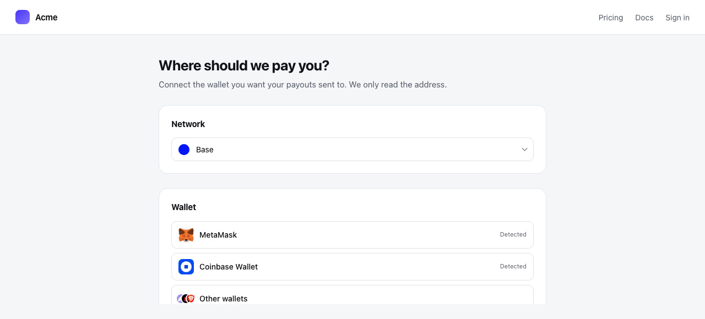
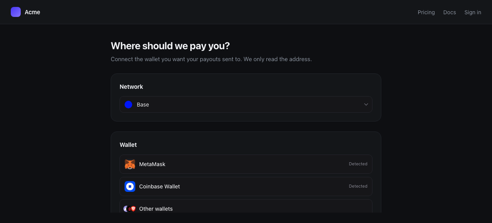

WalletKit is the wallet layer our own checkout runs on, published on its own so
you can use it anywhere you need a wallet in a browser. It has nothing to do
with taking a Reclack payment: reach for it when you need an address, a
balance, or a connection of your own.

```sh
npm install @reclack/walletkit
```

[`@reclack/walletkit` on npm](https://www.npmjs.com/package/@reclack/walletkit)

- **Any framework.** The picker is a custom element, and the connection layer
  is a plain object with `getState` and `subscribe`.
- **One dependency**, loaded only when somebody picks a wallet that needs it.
- **Nothing to configure.** Endpoints, the wallet catalog and relay pairing
  ship with working defaults.
- **Typed**, and safe to import in a server render.

## Quick start

```html
<script type="module">
  import '@reclack/walletkit/element'
</script>

<reclack-connect variant="modal" family="evm"></reclack-connect>
```

Importing `@reclack/walletkit/element` defines the tag. With no bundler, point
a module script at a CDN instead:

```html
<script type="module" src="https://esm.sh/@reclack/walletkit/element"></script>
```

```js
document.querySelector('reclack-connect')
  .addEventListener('connect', (event) => {
    console.log(event.detail.address)
  })
```

<Frame caption="The network picker and the wallet picker, inline in a page">
  
  
</Frame>

If you only need a value and not a component:

```ts
import { connectWallet } from '@reclack/walletkit/element'

const { address } = await connectWallet({ intent: ['address'], family: 'evm' })
```

## Your framework

### React, Next.js, Remix

```sh
npm install @reclack/walletkit @reclack/walletkit-react
```

[`@reclack/walletkit-react` on npm](https://www.npmjs.com/package/@reclack/walletkit-react)

```tsx
import { ReclackConnect } from '@reclack/walletkit-react'

<ReclackConnect
  variant="modal"
  family="evm"
  chainId={8453}
  intent={['address']}
  onConnect={({ address }) => setAddress(address)}
  onCancel={() => setOpen(false)}
/>
```

In Next.js, add `'use client'` to the file that renders it. Importing
`@reclack/walletkit` itself on the server is fine.

Preact needs no second package: the React one works through `preact/compat`.

### Vue

```sh
npm install @reclack/walletkit @reclack/walletkit-vue
```

[`@reclack/walletkit-vue` on npm](https://www.npmjs.com/package/@reclack/walletkit-vue)

```vue
<script setup>
import { ReclackConnect } from '@reclack/walletkit-vue'
</script>

<template>
  <ReclackConnect variant="modal" family="evm" :chain-id="8453" @connect="onConnect" />
</template>
```

### Angular, Svelte, Solid, plain HTML

No wrapper exists because none is needed. Each binds properties and listens for
events on a custom element natively, so use `<reclack-connect>` directly.

## The element

### Attributes

| Attribute | Values | Default | What it does |
| --- | --- | --- | --- |
| `variant` | `inline`, `modal` | `inline` | A list on the page, or the picker over it |
| `family` | `evm`, `svm` | `evm` | Which wallets to offer |
| `chain-id` | number | none | Require this chain, switching the wallet if needed |
| `intent` | `address`, `balance`, comma separated | `address` | What to return |
| `keep-alive` | present or absent | absent | Stay connected after resolving |
| `asset-base` | URL path | `/images/` | Where the wallet logos are served from |
| `api-url` | URL | Reclack's | A different deployment, such as a sandbox |

For anything an attribute cannot carry, set a property:

```js
element.kit = sharedKit
element.theme = { mode: 'dark', brand: '#ff6600' }
element.request = {
  intent: ['address', 'balance'],
  assets: [{ family: 'evm', chainId: 8453, token: USDC, decimals: 6 }],
}
```

### Events

| Event | Detail |
| --- | --- |
| `connect` | `{ address, chainId, walletId, name, family, balances }` |
| `cancel` | none, the person closed the picker |
| `connect-error` | `{ message }` |

All three are composed, so a listener on an ancestor hears them through the
shadow boundary. It is `connect-error` rather than `error` because `error`
already means a resource failed to load.

<Note>
The markup lives in a shadow root, so the picker cannot restyle your page and
your stylesheet cannot reach into it. Theme it with the attributes below, or by
setting any `--rkw-` token on the element.
</Note>

`variant="modal"` is a native `<dialog>`, so focus trapping, Esc to close, an
inert background and a backdrop all come from the browser.

## The network picker

The chain something settles on, as a second element. A checkout asks which
chain before it asks which wallet, and a form collecting a settlement address
asks which chain without connecting anything at all.

```html
<reclack-network
  networks="arc,base,ethereum,polygon,solana"
  value="base"
></reclack-network>
```

```js
document.querySelector('reclack-network')
  .addEventListener('change', (event) => {
    console.log(event.detail.network)
  })
```

| Attribute | Values | Default | What it does |
| --- | --- | --- | --- |
| `networks` | comma separated names | none | The chains to choose between |
| `value` | one of them | the first | The chain chosen, and settable |
| `disabled` | present or absent | absent | Stops it while something is in flight |
| `label` | text | `Network` | Empty renders no label at all |

## The kit

The element makes its own kit and you never have to touch one. Reach for the
kit directly when you want wallet state without a picker, or when several
pickers should share one.

```ts
import { createWalletKit } from '@reclack/walletkit'

const kit = createWalletKit()
const stop = kit.subscribe(() => render(kit.getState()))

const { evm, svm, catalog, handheld } = kit.getState()
evm.available   // the wallets this browser has
evm.connected   // { address, chainId, walletId, name } once one is
```

| Method | What it does |
| --- | --- |
| `getState()` | The whole state, as one object |
| `subscribe(fn)` | Calls `fn` on every change, returns an unsubscribe |
| `connectEvm(wallet)`, `connectSvm(wallet)` | Connect one from `available` |
| `connectRemote(wallet, chainId, onUri)` | Pair by QR code |
| `resolveIntent(family, request)` | Connect and return what you asked for |
| `readBalances(family, assets)` | Balances for a connected address |
| `ensureChain(chainId)` | Switch the wallet's chain, true if it is there |
| `setTheme(theme)` | Replace the theme, such as when branding loads |
| `disconnect(family?)` | Drop the session |
| `destroy()` | Release listeners |

`getState` and `subscribe` are all any framework needs, which is why there are
only two wrappers:

```ts
// React
const state = useSyncExternalStore(kit.subscribe, kit.getState, kit.getState)

// Vue
const state = shallowRef(kit.getState())
onMounted(() => kit.subscribe(() => { state.value = kit.getState() }))
```

Discovering wallets means a window listener and a catalog fetch, so a page with
several pickers should share one kit: `element.kit = myKit`. Themes stay per
element, so one kit can serve a light picker in a panel and a dark one in a
drawer.

## Intent

What you want back from connecting, as a list rather than a mode, because these
are not alternatives.

```ts
const result = await kit.resolveIntent('evm', {
  intent: ['address', 'balance'],
  assets: [{ family: 'evm', chainId: 8453, token: USDC, decimals: 6 }],
  keepAlive: false,
})
```

- `address` always comes back. Listing it says you want it handed to you.
- `balance` needs an asset to be a balance of. Asking without one throws.
- `keepAlive` holds the connection open and keeps following account and chain
  changes. True for a checkout that signs later, false for a form that wanted
  a value and is done.

A chain is enforced only when you pass `chainId`. Leave it out when collecting
a settlement address: the same address receives on every EVM chain, so asking
somebody to switch networks to read it back serves no purpose.

## Theming

Twelve tokens, light or dark.

```ts
createWalletKit({
  theme: {
    mode: 'system',               // 'light' | 'dark' | 'system'
    brand: '#ff6600',             // worn by the primary action
    radius: '14px',
    fontFamily: 'Inter, sans-serif',
    dark: { surface: '#000000' }, // applied on top, in dark only
  },
})
```

A nested object will not fit in an attribute, so the four values a plain HTML
page is most likely to want have one each:

```html
<reclack-connect theme-mode="dark" brand="#ff6600" radius="14px"></reclack-connect>
```

| Attribute | Theme field | Values | Default |
| --- | --- | --- | --- |
| `theme-mode` | `mode` | `light`, `dark`, `system` | `system` |
| `brand` | `brand` | `#rrggbb` | Reclack's |
| `radius` | `radius` | CSS length | `10px` |
| `font` | `fontFamily` | CSS font stack | inherited |

A `theme` property wins over all four, as does sharing a kit that already
carries one. That is deliberate: a checkout that themed its kit should not have
to theme every picker inside it as well.

## Server rendering

Importing the package on a server is safe: nothing touches `window` until you
create a kit or the element upgrades. Import
`@reclack/walletkit/element` in a client file only, since defining a custom
element needs a document.

## TypeScript

Types ship with both packages.

```ts
import type {
  WalletKit,
  WalletKitTheme,
  WalletEntry,
  ConnectRequest,
  ConnectResult,
} from '@reclack/walletkit'
```
