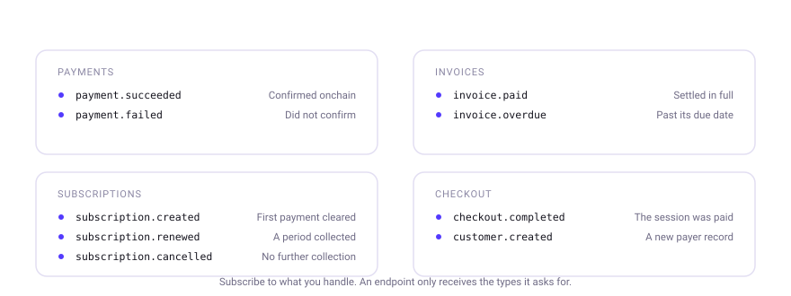
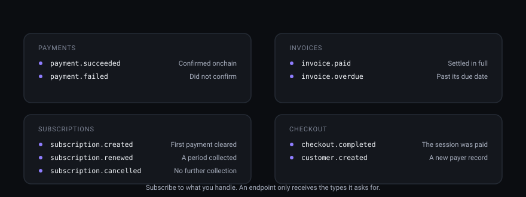

Event types read as `object.what_happened`, in the past tense, because an event
is a record of something that already happened. The strings are part of the
contract: they are added to, never renamed.

<Frame caption="The events Reclack emits, grouped by the object they belong to">
  
  
</Frame>

## What every payload carries

Beyond the object's own fields, each event carries the public ids of the
objects it points at and the metadata you set yourself. That is what lets a
receiver file an event against its own records without reading anything back.

| Field | On | Meaning |
| --- | --- | --- |
| `customer_id` | every event with a customer behind it | Who paid, or who is subscribed. |
| `subscription_id` | payments, invoices, checkouts | The schedule this belongs to, when there is one. |
| `invoice_id` | payments | The invoice a payment settled. |
| `payment_link_id` | payments | The link a payer came through. |
| `payment` | renewals, completed checkouts | The payment that settled it. |
| `metadata` | checkouts, subscriptions, invoices | Your own keys on the object the event is about. |

A field that does not apply is left out rather than sent empty, so testing for
`subscription_id` is a safe way to tell a renewal from a one-off payment.

```json
{
  "id": "evt_4Kd9ZmPq",
  "type": "checkout.completed",
  "created_at": "2026-10-18T22:07:41Z",
  "data": {
    "id": "chk_7Fh2PqX9Lm",
    "status": "completed",
    "payment": "pay_2Pb8xk9",
    "customer_id": "cus_7Fh2PqX9",
    "subscription_id": "sub_4Kd9",
    "metadata": { "order_id": "A-1829" }
  }
}
```

<Note>
`metadata` is your keys only. `fee_payer`, which every payable records whether
or not you set it, is ours and does not travel here.
</Note>

## Metadata on a subscription

A subscription inherits the metadata of the checkout or payment link that
started it, and every renewal repeats it.

This is the thread worth setting up front. A renewal arrives months later with
no payer in the loop and no checkout left to read, so metadata you set at
signup is the only thing on that event that your own system recognises.

```bash
curl -X POST "https://api.reclack.com/v1/checkouts" \
  -H "Api-Key: $RECLACK_KEY" \
  -H "Content-Type: application/json" \
  -d '{
    "price_id": "price_7Fh2PqX9",
    "metadata": { "account_id": "acct_41", "seat": "12" }
  }'
```

Every `subscription.renewed` for the subscription that checkout creates carries
that same `account_id` and `seat`.

## Payments

| Type | Fires when | Act on it by |
| --- | --- | --- |
| `payment.succeeded` | A transaction confirmed onchain. | Marking the payment settled in your records. |
| `payment.failed` | A collection attempt failed for a reason that is the payer's or the chain's: a short balance, an exhausted allowance, a charge the chain refused, or an authorization that has ended. | Noting it. Retries are already scheduled, so most teams keep access on until the subscription pauses. |

<Note>
A collection Reclack held rather than attempted does not emit
`payment.failed`. A screening hold, a transaction of ours that never left, or
a relayer we could not use are all retried within the hour, and announcing
them would have you cut off a customer for an outage of ours.
</Note>

## Invoices

| Type | Fires when | Act on it by |
| --- | --- | --- |
| `invoice.paid` | An invoice was reconciled against a confirmed transaction. | Closing the bill in your books. |
| `invoice.overdue` | The due date passed with the invoice still open. | Reaching out, or letting the reminders do it. |

## Subscriptions

| Type | Fires when | Act on it by |
| --- | --- | --- |
| `subscription.created` | A recurring checkout completed. | Granting access. |
| `subscription.renewed` | A period collected and reconciled. | Extending access to `next_charge_at`, which the event carries. |
| `subscription.cancelled` | The customer or you ended it. | Ending access when the period runs out. |

## Checkout

| Type | Fires when | Act on it by |
| --- | --- | --- |
| `checkout.completed` | A session was paid. | Fulfilling whatever the session was for. |

## Customers

| Type | Fires when | Act on it by |
| --- | --- | --- |
| `customer.created` | A new customer record was made, including by a payer at checkout. | Linking it to your own user, usually through `external_id` or the email. |

## Subscribing

An endpoint subscribes to the types it wants. Subscribing to a type that will
never fire is a configuration that produces silence, so we refuse unknown types
at the form rather than letting you discover it months later.

```bash
curl -X PATCH "https://api.reclack.com/v1/webhooks/whe_7Fh2PqX9" \
  -H "Api-Key: $RECLACK_KEY" \
  -H "Content-Type: application/json" \
  -d '{
    "event_types": [
      "subscription.created",
      "subscription.renewed",
      "subscription.cancelled",
      "invoice.paid",
      "payment.failed"
    ]
  }'
```

The current list is also available from the API, which is handy for building a
settings screen:

```bash
curl "https://api.reclack.com/v1/event-types" \
  -H "Api-Key: $RECLACK_KEY"
```

## A note on ordering

Events are not guaranteed to arrive in the order they happened. A retry can
land after a later event. Treat each one as a statement about an object at a
point in time, and read the object back if the order matters to what you do
next.
